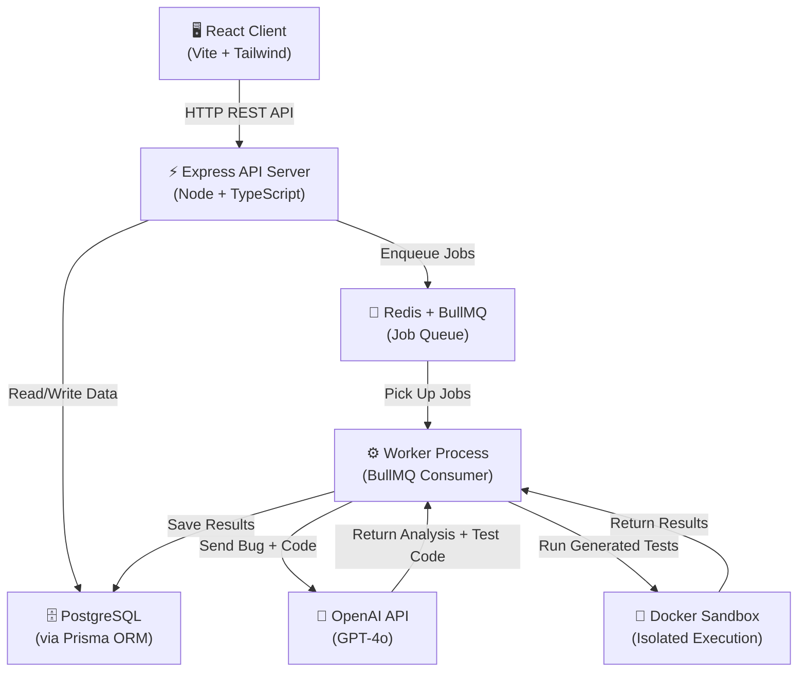

# Architecture — ReproForge

## System Diagram

## Component Descriptions

### 🖥️ React Client
- Built with Vite, React, TypeScript, and Tailwind CSS
- Handles all user interaction: login, project upload, bug submission, viewing results
- Communicates with the API server via REST calls
- Uses TanStack Query for data fetching and caching

### ⚡ Express API Server
- Central hub of the application — receives all requests from the client
- Validates input, authenticates users, and orchestrates operations
- Enqueues background jobs (AI investigation) into the job queue
- Returns data from the database to the client

### 🗄️ PostgreSQL
- Stores all persistent data: users, projects, bug reports, test runs
- Accessed via Prisma ORM for type-safe queries
- Runs in a Docker container via docker-compose

### 📮 Redis + BullMQ
- Redis acts as the message broker for the job queue
- BullMQ manages job scheduling, retries, and prioritization
- Jobs are things like "investigate this bug report with AI"
- Decouples the API server from slow operations (AI calls take seconds)

### ⚙️ Worker Process
- A separate Node.js process that consumes jobs from the queue
- Sends bug report + source code to the LLM API
- Receives the AI's analysis and generated test code
- Triggers Docker sandbox execution
- Saves results back to the database

### 🤖 OpenAI API (LLM)
- External AI service that analyzes bug reports
- Receives: bug description + relevant source code files
- Returns: analysis of what might be wrong + runnable test code to reproduce the bug

### 🐳 Docker Sandbox
- Isolated container where generated test code runs
- Has Node.js and common testing tools pre-installed
- No network access to host, CPU/memory limits enforced
- Captures stdout, stderr, exit code, and execution duration
- Destroyed after each run — no state persists

## Data Flow (Happy Path)

1. User uploads a project (ZIP) and submits a bug report
2. API server saves the bug report to PostgreSQL
3. API server enqueues an "investigate" job to Redis/BullMQ
4. Worker picks up the job
5. Worker sends bug report + project source code to OpenAI
6. OpenAI returns analysis + generated test code
7. Worker saves the AI response to PostgreSQL
8. Worker spins up a Docker container, copies in the test code, runs it
9. Container execution results (stdout, stderr, exit code) are captured
10. Worker saves results to PostgreSQL
11. Client polls/fetches the updated bug report and shows results to the user
